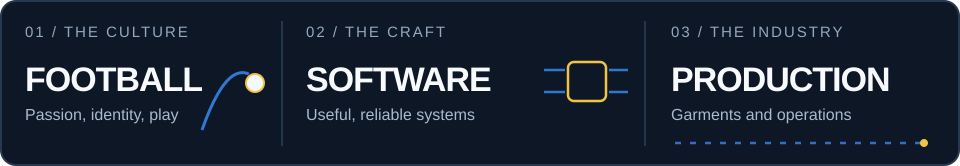

  <picture>
    <source media="(prefers-reduced-motion: reduce)" srcset="./assets/profile-hero-static.svg" />
    
  </picture>

  

### Where operations meet product design.

I'm a **business operator and product builder** based in Chattogram, Bangladesh. My work connects retail, ready-made garment manufacturing, and software—turning day-to-day operational problems into more useful digital experiences.

**What matters to me:** clear interfaces, dependable systems, measurable improvements, and a little football along the way.

[Current work](#01--current-work) · [Design projects](#02--design--side-projects) · [Tools](#03--tools--practice) · [Get in touch](#04--elsewhere)

---

## 01 / Current work

### [Lucky Store](https://luckystore1947.com) — Retail, rebuilt

A neighbourhood retail business with a growing digital storefront and operating toolkit. I'm working across the shopping experience and the less-visible systems behind it: catalogues, inventory, point of sale, and operational workflows.

**Explore:** [Live storefront](https://luckystore1947.com) · [POS and storefront code](https://github.com/fatalmonk/luckystorePOS)

### [Kattali Textile Limited](https://www.ktlbd.com/) — Manufacturing meets information

A ready-made garment manufacturer. My work includes its company website and exploring how production data can be made clearer and more useful for factory decisions.

**Explore:** [Company website](https://www.ktlbd.com/) · [Website code](https://github.com/fatalmonk/ktlbdOnline) · [Production analysis](https://github.com/fatalmonk/KTL-Production-Analysis)

### StitchOS — Factory-floor visibility

An in-development garment manufacturing execution system exploring RFID-assisted tracking, work-in-progress visibility, and traceable factory events.

**Status:** In development · Private codebase

---

## 02 / Design & side projects

### [STRYV](https://stryv-xi.vercel.app/) — Football × streetwear

Football-inspired apparel meets a visual-first e-commerce experience, with an emphasis on movement and a distinctive identity.

[Visit website](https://stryv-xi.vercel.app/) · [View repository](https://github.com/fatalmonk/STRYV)

### [The Abusement Park](https://the-abusement-park.pages.dev/) — Fantasy football archive

An FPL mini-league hall of fame, with leaderboards, past champions, season histories, and plenty of nostalgia.

[Visit website](https://the-abusement-park.pages.dev/) · [View repository](https://github.com/fatalmonk/The-Abusement-Park)

### [For the Ummah](https://github.com/fatalmonk/fortheummah) — Puzzles & discovery

An Islamic puzzle project with an enquiry-only shop experience taking shape.

[View repository](https://github.com/fatalmonk/fortheummah)

Selected work includes active builds and experiments. Not every feature or deployment is production-ready.

---

## 03 / Tools & practice

  

**Languages & interfaces**

    

**Services & infrastructure**

    

I also work with **Tailwind CSS, Dart, Redis, and GitHub Actions**, with particular interest in bilingual retail UX, reliable POS workflows, production traceability, analytics, SEO, and applied AI.

Badges show technologies used across projects—not certifications, partnerships, or endorsements. Badge format inspired by [Badges4-README.md-Profile](https://github.com/alexandresanlim/Badges4-README.md-Profile).

---

## 04 / Elsewhere

[All repositories](https://github.com/fatalmonk?tab=repositories) · [Lucky Store](https://luckystore1947.com) · [KTL](https://www.ktlbd.com/) · [STRYV](https://stryv-xi.vercel.app/)

with &lt;3 from Chittagong
