# mac.alvi / fatalmonk

<picture>
  <source media="(prefers-reduced-motion: reduce)" srcset="./assets/profile-hero-static.svg" />
  
</picture>

**Business operator · Product builder · Applied software & AI**

Based in Chattogram, Bangladesh. I work across retail, ready-made garment manufacturing, and software—building systems around real operating needs rather than demo-only features.

My work connects **Lucky Store**, **Kattali Textile Limited (KTL)**, and emerging software initiatives. I focus on making commerce and factory operations more measurable, reliable, and accessible.

## What I'm building

| Project | What it does | Code / status |
| --- | --- | --- |
| **Lucky Store** | Retail point of sale, stock workflows, and an English/Bengali e-commerce storefront for a family retail business established in 1947. | [luckystorePOS](https://github.com/fatalmonk/luckystorePOS) · [Storefront](https://luckystore1947.com) |
| **Kattali Textile Limited** | Digital presence and operational analytics for a Bangladesh ready-made garment manufacturer and exporter. | [ktlbdOnline](https://github.com/fatalmonk/ktlbdOnline) · [Production analysis](https://github.com/fatalmonk/KTL-Production-Analysis) |
| **StitchOS** | In-development manufacturing execution system exploring production events, work-in-progress visibility, and RFID-based traceability. | Private development |
| **Hermes Jev Skills** | Experiments with decision-model-assisted agent routing, retrieval, and workflow selection. | [Repository](https://github.com/fatalmonk/hermes-jev-skills) |
| **STRYV** | Football-inspired streetwear e-commerce application. | [Repository](https://github.com/fatalmonk/STRYV) |
| **For the Ummah** | Islamic puzzle catalogue with a staged, enquiry-only commerce flow. | [Repository](https://github.com/fatalmonk/fortheummah) |

## Technology in my projects

- **Web:** TypeScript, JavaScript, React, Next.js, Tailwind CSS
- **Apps and services:** Flutter, Dart, Python, FastAPI
- **Data and infrastructure:** PostgreSQL, Supabase, Redis, Docker, Cloudflare
- **Focus areas:** bilingual retail UX, POS reliability, factory traceability, analytics, SEO, security, and AI-assisted engineering

## How I approach projects

I prioritize operational fit, testable changes, access controls, measurable performance, and clear separation between proposals, verified results, and production releases.

Much of my work is iterative. A public repository or prototype does **not** necessarily mean a feature is deployed or a business service is accepting orders.

## Explore

[GitHub repositories](https://github.com/fatalmonk?tab=repositories) · [Lucky Store](https://luckystore1947.com) · [Lucky Store POS](https://github.com/fatalmonk/luckystorePOS) · [KTL website code](https://github.com/fatalmonk/ktlbdOnline)

---

Last updated: 2026-11-26
