  <picture>
    <source media="(max-width: 520px)" srcset="./assets/profile-hero-mobile.svg" />
    <source media="(prefers-reduced-motion: reduce)" srcset="./assets/profile-hero-static.svg" />
    
  </picture>

### Business operations × product engineering

I help turn practical problems in **retail and garment manufacturing** into better digital systems. Based in Chittagong, Bangladesh, I work across business operations, product decisions, and hands-on software development.

**My focus:** usable interfaces, dependable workflows, measurable evidence, and football culture.

[Selected work](#01--selected-work) · [Side projects](#02--design--side-projects) · [Working stack](#03--working-stack) · [Contact](#04--contact)

---

## 01 / Selected work

### [Lucky Store](https://luckystore1947.com) — Modernizing neighbourhood retail

**The problem:** Connect a long-running Chittagong retail business with the digital shopping experience and the daily work behind it.

**My contribution:** Product and operational work across the customer storefront, POS, catalogue, inventory interfaces, and supporting workflows. The work connects the online shopping experience with the operational systems that support it.

**Evidence:** [Live storefront](https://luckystore1947.com) · [Storefront and POS source](https://github.com/fatalmonk/luckystorePOS)

**Status:** Customer storefront is live; POS and operations tooling continue to evolve. The linked repository documents the implementation and ongoing changes.

### [Kattali Textile Limited](https://www.ktlbd.com/) — Making factory information useful

**The problem:** Production and operational decisions need reliable, understandable information—not just more spreadsheets or dashboards.

**My contribution:** Work involving the company's web presence and production-analysis tooling, connecting a manufacturing operator's perspective with software and data workflows.

**Evidence:** [Company website](https://www.ktlbd.com/) · [Website code](https://github.com/fatalmonk/ktlbdOnline) · [Production-analysis project](https://github.com/fatalmonk/KTL-Production-Analysis)

**Status:** Website and analysis projects are available for inspection. Production-wide analytics deployment and measured uplift have not been independently verified.

### [StitchOS](https://github.com/fatalmonk/stitchos) — Building toward traceable production

**The problem:** A raw RFID read alone cannot establish that an operation was completed, or that factory work-in-progress is trustworthy.

**My contribution:** Product and engineering direction for a security-first, RFID-aware manufacturing execution system designed around validated factory events, an authoritative Ledger, and rebuildable Trace views.

**Evidence:** [Development repository](https://github.com/fatalmonk/stitchos) · [Architecture reference](https://app.notion.com/p/28efe7a68af880b28771d3e88752934f)

**Status:** **Under development; not commissioned or production-qualified.** Signed Edge-to-Core ingestion, durable replay, and the KTL pilot still require verification.

View the elevated terminal — a visual map of the work

  

---

## 02 / Design & side projects

### [STRYV](https://stryv-xi.vercel.app/) — Football meets streetwear

A football-inspired visual commerce experiment, developed around apparel, identity, and movement.

**Explore:** [Website](https://stryv-xi.vercel.app/) · [Repository](https://github.com/fatalmonk/STRYV)

### [The Abusement Park](https://the-abusement-park.pages.dev/) — Fantasy football archive

An FPL mini-league hall of fame exploring leaderboards, champions, and season history.

**Explore:** [Website](https://the-abusement-park.pages.dev/) · [Repository](https://github.com/fatalmonk/The-Abusement-Park)

### [For the Ummah](https://github.com/fatalmonk/fortheummah) — Puzzles & discovery

An Islamic puzzle and discovery project with an enquiry-oriented commerce concept in progress.

**Explore:** [Repository](https://github.com/fatalmonk/fortheummah)

*These projects include experiments and active development; links do not imply that every planned feature is released.*

---

## 03 / Working stack

**Interfaces:** TypeScript · React · Next.js · Flutter · Tailwind CSS

**Services and data:** Python · FastAPI · PostgreSQL · Supabase · Cloudflare · GitHub Actions

I use tools according to the operational problem: bilingual catalogue UX, retail POS, production analysis, traceability, testing, and deployment discipline. This is a selection of technologies used in projects, not a certification list.

---

## 04 / Contact

For a **public project or collaboration enquiry**, [open an issue in this profile repository](https://github.com/fatalmonk/fatalmonk/issues/new). Issues are publicly visible, so do not include confidential or personal information.

[Browse repositories](https://github.com/fatalmonk?tab=repositories) · [Lucky Store](https://luckystore1947.com) · [Kattali Textile Limited](https://www.ktlbd.com/)

Built in Chittagong. Grounded in operations, expressed through products.
